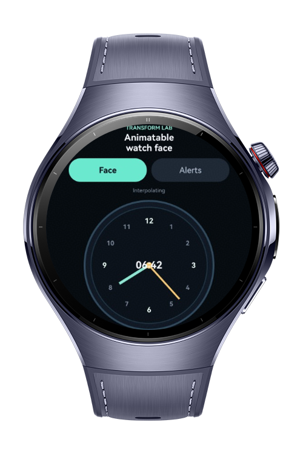
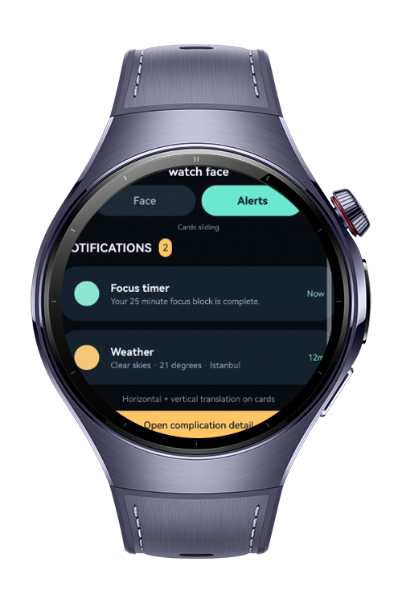
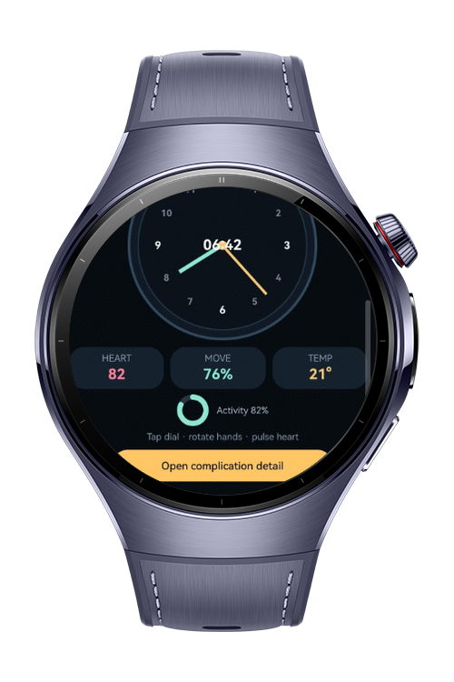

> **Note:** To access all shared projects, get information about environment setup, and view other guides, please visit [Explore-In-HMOS Index](https://github.com/Explore-In-HMOS/hmos-index).

# How to build Animatable Transform

This app is a wearable animation playground demonstrating all transform primitives for watch-face design. It uses `@AnimatableExtend` to define custom animatable properties such as gauge needle angles and ring progress values, `Transition` for watch-screen changes, `Modal Transition` for complication detail overlays, `Transformation` for combined transforms, `Translation` for notification cards, `Rotation` for clock hands, `Scale` for heart-rate indicators, and `Pivot` for clock-hand anchor points.

# Preview

<div>
  
  
  
</div>

# Use Cases

- Custom animatable gauge needle angles with `@AnimatableExtend`
- Custom animatable activity ring progress with `@AnimatableExtend`
- Watch-screen enter and exit animations with `Transition`
- Complication detail slide-up overlay with `Modal Transition`
- Combined translation, scale, and rotation with `Transformation`
- Horizontal and vertical notification-card movement with `Translation`
- Analog clock-hand and loading-indicator movement with `Rotation`
- Heart-rate pulse and tap zoom effects with `Scale`
- Clock-hand base anchoring at the 6-o'clock position with `Pivot`
- Compact layout behavior for round wearable screens

# Technology
## Stack

- **Languages**: ArkTS, ArkUI
- **Frameworks**: HarmonyOS SDK 6.0.1(21)
- **Tools**: DevEco Studio 6.0.1, Hvigor
- **Libraries**:
    - `@kit.ArkUI`
    - `@kit.AbilityKit`

# Directory Structure

```
entry/src/main/ets/
├──entryability
|       EntryAbility.ets
├──pages
        Index.ets
sample-code/
        Index.ets
```

# Constraints and Restrictions

## Supported Device

* Huawei Watch 5
* HarmonyOS wearable emulator

# License

**How to build Animatable Transform** is distributed under the terms of the MIT License. See the [LICENSE](LICENSE) for more information